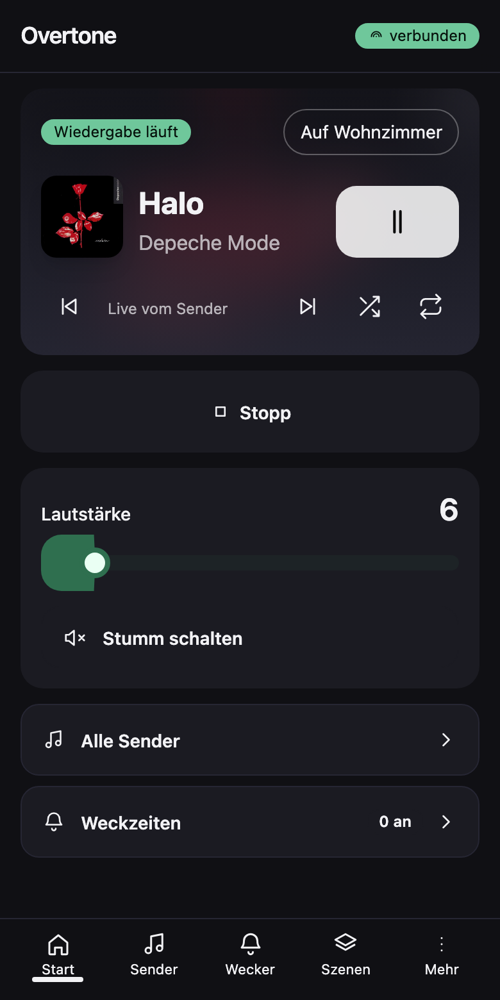

# Overtone

A small self hosted remote for a Sonos speaker. No Sonos account, no cloud, no app.
Everything runs on your own machine and talks to the speaker over the local network.

Built for a household speaker that should be easy to use from a phone: stations,
alarms, scenes, sound settings, spoken announcements, sleep sounds and a child lock.



## What it does

- **Stations** – keep a list of radio streams, start and stop them. Live title and
  cover are read from the stream itself (ICY metadata) and shown while playing.
- **Now playing** – player card with cover, title, artist, progress, shuffle and
  repeat. Works for streams, for announcements and for a Spotify Connect session.
- **Alarms** – the alarm list lives on the speaker, so it rings even without this app.
- **Scenes** – several actions, one button.
- **Sound and light** – bass, treble, loudness, play mode, crossfade, LED state.
- **Announcements and sounds** – type a text and the speaker reads it out (macOS
  `say`), or generate sleep sounds such as rain, sea, noise and night with `ffmpeg`.
- **Child lock** – silences the speaker, forces volume to zero, locks the device
  buttons and stops playback until the lock is released. PIN stored as scrypt hash.
- **Backup** – stations, scenes, alarms and settings as a JSON file.

## Requirements

- macOS or Linux with Node 20 or newer
- a Sonos speaker in the same network
- `say` and `ffmpeg` only for announcements and generated sounds

## Install

```sh
git clone https://github.com/weuxstudio/overtone.git
cd overtone
npm install
npm run build
PORT=8770 HOST=0.0.0.0 ORIGIN=http://127.0.0.1:8770 node build/index.js
```

Then open `http://127.0.0.1:8770`.

## Configure the speaker

On first start the file `~/.overtone/config.json` is created. Fill in the address
and the identifier of your speaker:

```json
{
  "host": "192.168.1.50",
  "uuid": "RINCON_00000000000000000",
  "callbackHost": "192.168.1.10",
  "notifyPort": 8771,
  "serviceName": "Overtone"
}
```

- `host` – local address of the speaker, port 1400 is used for the UPnP calls
- `uuid` – speaker identifier, shown in the Sonos app under system information
- `callbackHost` – address of the machine running Overtone, needed so the speaker
  can send its events back. Leave empty to detect it.
- `notifyPort` – local port for those events

Data lives in `~/.overtone`: database with stations, scenes and settings, generated
audio under `~/.overtone/ton`, backups under `~/.overtone/sicherungen`.

Run one instance per installation. The service listens for events from the speaker
on `notifyPort` (8771 by default) and that port must stay free: when it is taken, a
start falls back to a spare port, the box keeps sending its events to the older
process and the display stops following the speaker. Give a second installation its
own `notifyPort`. Stop the service with `kill` (SIGTERM); it closes within a few
seconds.

The station list starts with three widely known public streams as examples. Replace
them in the app with whatever you listen to.

## Reach it from a phone

The service listens on `0.0.0.0`, so the local address works inside the network.
For access from outside, a private network such as Tailscale is the intended way:
expose port 8770 through it and open the resulting address on the phone.

## Access without a password

There is no login. Access is decided by the network the service is reachable from,
so keep it inside your own network or a private overlay network. Only the child
lock, which guards the speaker, asks for a PIN.

## Structure

```
src/lib/server/     device access, streams, alarms, scenes, lock, audio
src/lib/client/     shared state, dialogs, icons
src/routes/         pages and API endpoints
```

## Notes

Sonos, Spotify and Apple Music are trademarks of their owners. This project is not
affiliated with any of them. It speaks the local UPnP interface that the speakers
offer in the network.

## License

MIT
